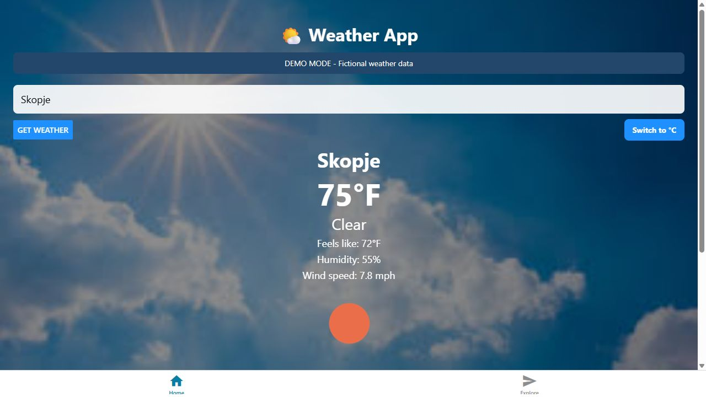
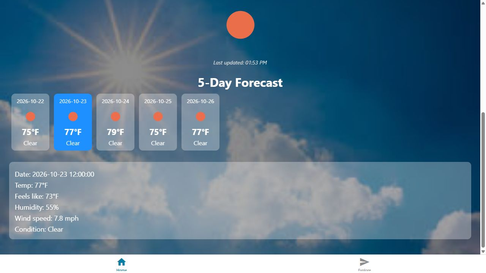
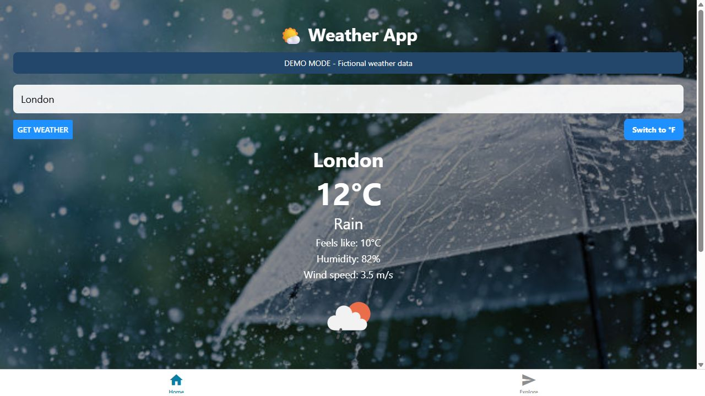
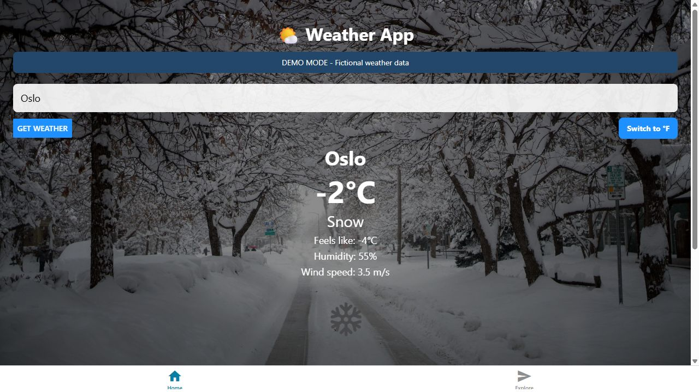

# Weather App

A weather dashboard built with **React Native, Expo and TypeScript** by **Antonio Puceski**. Search a city, view current conditions, explore a five-day forecast and switch between Celsius and Fahrenheit. Background photography changes with the reported weather.

## Preview


The images below are captures of the running web app using **fictional demo data**, not live weather observations. The 20-second MP4 and GIF are a slideshow of five captured screens, not a continuous interaction recording. Native Android/iOS screenshots are not included.


[Watch or download the MP4](docs/media/demo.mp4)

| Unit conversion | Forecast details |
| --- | --- |
|  |  |

| Rain background | Snow background |
| --- | --- |
|  |  |

## Features

- City search through OpenWeather current-weather and forecast endpoints.
- Temperature, feels-like temperature, humidity, wind and condition icons.
- Up to five daily forecast cards; selecting one reveals its details.
- Metric/imperial switching converts current and forecast temperatures and wind speeds immediately.
- Local background images for clear skies, clouds, drizzle, mist, rain, snow and thunderstorms.
- Loading indication, a last-updated time and a clearly labeled demo mode.

## Run locally

Install Node.js and npm, then clone this repository and run:

```bash
npm ci
```

Copy `.env.example` to `.env` (`Copy-Item .env.example .env` in PowerShell, or `cp .env.example .env` in a Unix shell).

### Try the portfolio demo without an API key

Set this in `.env`:

```dotenv
EXPO_PUBLIC_DEMO_MODE=true
```

```bash
npm run web
```

Search **Skopje** for clear conditions, **London** for rain, or **Oslo** for snow. Other names use the clear-weather fixture. Dates and measurements are fixed sample values. Weather icons still load from OpenWeather's image service, so a completely offline session may not show icons.

### Use live weather

Set the following in `.env`, replacing the placeholder with your own OpenWeather key:

```dotenv
EXPO_PUBLIC_DEMO_MODE=false
EXPO_PUBLIC_OPENWEATHER_API_KEY=your-key-here
```

Restart Expo after changing configuration. `npm start` opens the Expo development server; `npm run android` and `npm run ios` launch supported local development targets. The iOS simulator requires macOS. This documentation update verified the web target only.

**Key handling:** Expo public environment variables are embedded in the client bundle. Do not treat this key as a server-side secret. A previous version committed a key directly in source; its owner must revoke or rotate that key. Removing it from current files does not remove it from Git history. No live key is needed for the supplied demo.

## Implementation

```text
City search -> Axios -> OpenWeather current + forecast endpoints
                       -> metric values stored in React state
                       -> display conversion + weather-dependent background
```

| Path | Purpose |
| --- | --- |
| `app/(tabs)/index.tsx` | Search, weather display and forecast selection |
| `utils/units.ts` | Shared temperature and wind conversion |
| `utils/demoWeather.ts` | Explicitly fictional preview fixtures |
| `assets/images/` | Condition backgrounds and app assets |
| `scripts/test-units.cjs` | Conversion regression checks |
| `docs/media/` | Captured screenshots, GIF and MP4 |

The stack uses Expo SDK 53, React Native 0.79, React 19, Expo Router, TypeScript and Axios. The Explore tab and supporting template components remain from the Expo starter.

## Checks

```bash
npm run lint
npx tsc --noEmit
node scripts/test-units.cjs
npx expo export --platform web
```

During the portfolio update, lint and TypeScript checks passed, seven conversion assertions passed, and the web build exported successfully. Browser checks covered city search, Celsius/Fahrenheit switching, forecast selection and clear/rain/snow backgrounds using demo fixtures. Live API responses and native devices were not tested.

## Current limitations and next steps

- The forecast selects entries labeled `12:00:00` in the provider response. These are timestamp samples, not daily high/low summaries or guaranteed city-local noon.
- Errors currently use a generic alert; distinguishing invalid keys, unavailable cities and network failures would improve the experience.
- The October 2026 dependency audit reported 65 advisories (3 low, 20 moderate, 39 high and 3 critical) across the dependency tree. Expo also reported version alignment warnings. The dependency stack needs a tested upgrade before production deployment; this update does not resolve those advisories.
- A weather service proxy, stricter response types and native device testing would be useful next improvements.

This project demonstrates API integration, React state management, conditional styling and a shared mobile/web interface. The media makes those features easy to explore without configuring an API account.
